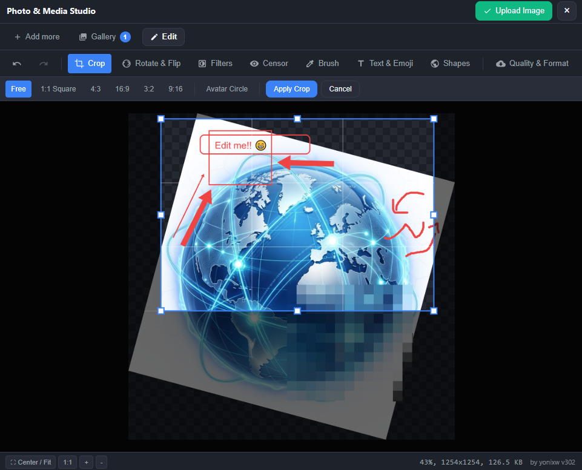

# ImageUploadEdit

A standalone, client-side HTML5 image uploader and multi-tool image editor. No build step and no runtime dependencies (the optional AI Background tool loads its model on first use). Works out of the box in an iframe modal, a popup window, a new browser tab, or as a standalone app.

> **AI Disclosure:** This project was developed and designed with the assistance of AI (**Google Gemini 3.7** and **Anthropic Claude**).

See DEMO here: https://yonixw.github.io/ImageUploadEdit/example_using_editor.html




## Features

- **Ingestion:** Drag & drop files/folders, folder picker, camera snap, clipboard paste (`Ctrl+V`).
- **Editing Tools:**
  - **Crop & Mask:** Freeform, 1:1 (with avatar circle mask option), 4:3, 16:9, 3:2, 9:16.
  - **Transform:** 90° CW/CCW, 180°, horizontal & vertical flips.
  - **Filters & Adjustments:** Brightness, Contrast, Saturation, Warmth, Grayscale, Sepia, Invert, B&W.
  - **Censor:** Pixelate and Blur with Box, Brush, Freehand-In, and Freehand-Out selection modes.
  - **Auto Background fix:** Download to the device 16mb ai model to detect background and blur it without any 3rd party sharing.
  - **Brush:** Freehand drawing with adjustable stroke size, color, and opacity.
  - **Shapes:** Rectangle, Rounded Rectangle, Circle/Ellipse, Straight Line, Arrow, and Star with solid/dashed stroke and fill styles.
  - **Text & Emoji:** Drag-and-drop text with rotation, custom font, bold, italic, and badge background plate.
  - **Export Optimization:** WebP, JPEG, PNG formats with live size estimation and max resizing dimension presets.
- **Single Image Mode:** `?single=true` turns the editor into a one-shot flow: pick one image, edit it, then upload or close. The queue, gallery, and "Upload All" are hidden, and the host opens a new editor for the next image.
- **Multi-Theme Support:**
  - **Dark Themes:** `dark` (default), `midnight` (deep navy), `emerald` (forest slate), `dark-orange`, `glass` (glassmorphism).
  - **Light Themes:** `light` (clean modern), `warm-light` (editorial minimal).
- **Multi-Language Support:** English, Hebrew (RTL), Japanese, German. Selected via `?lang=`, the browser language, or the host `INIT` / `SET_LANG` message. Translations live in `js/i18n/lang_*.js`.

---

## How to Embed the Editor in Any Web Page

You only need `editor.html` (along with its `js/` and `theme/` folders). You can integrate it via **Iframe Modal**, **Popup Window**, or **New Tab**. You can also use the hosted version at https://yonixw.github.io/ImageUploadEdit/editor.html

### 1. Iframe Modal Embedding

```html
<!-- Container modal in your host page -->
<div id="editorModal" style="display:none; position:fixed; inset:0; background:rgba(0,0,0,0.7); z-index:9999;">
  <iframe id="editorIframe" style="width:100%; height:100%; border:none;"></iframe>
</div>

<script>
function openEditorIframe(token = 'session_123', theme = 'dark') {
  const params = `token=${encodeURIComponent(token)}&theme=${encodeURIComponent(theme)}&autoClose=true`;
  const iframe = document.getElementById('editorIframe');
  
  // Pass params in both search query and hash for maximum compatibility
  iframe.src = `editor.html?${params}#${params}`;
  document.getElementById('editorModal').style.display = 'block';
}
</script>
```

### 2. Popup Window Embedding

```javascript
function openEditorPopup(token = 'session_123', theme = 'midnight') {
  const params = `token=${encodeURIComponent(token)}&theme=${encodeURIComponent(theme)}&autoClose=true`;
  const url = `editor.html?${params}#${params}`;
  window.open(url, 'ImageEditorPopup', 'width=1150,height=850,resizable=yes');
}
```

### 3. Open in New Tab Embedding

```javascript
function openEditorNewTab(token = 'session_123', theme = 'midnight') {
  const params = `token=${encodeURIComponent(token)}&theme=${encodeURIComponent(theme)}&autoClose=true`;
  const url = `editor.html?${params}#${params}`;
  window.open(url, '_blank');
}
```

---

## Receiving Uploaded Images

The editor communicates back to the parent host page via `window.postMessage` and direct `window.edited_upload` fallback.

### `postMessage` Listener (Recommended)

```javascript
window.addEventListener('message', (event) => {
  const data = event.data;
  if (!data || typeof data !== 'object') return;

  // 1. Handshake received when editor loads
  if (data.type === 'EDITOR_READY') {
    console.log('Editor is ready, session token:', data.token);
  }

  // 2. Edited image returned
  if (data.type === 'IMAGE_UPLOAD_ITEM') {
    const payload = data.payload;
    console.log('Received image:', payload.name);
    console.log('Dimensions:', payload.width, 'x', payload.height);
    console.log('Blob:', payload.blob);
    console.log('Base64 Data URL:', payload.dataUrl);
    console.log('Token:', payload.token);

    // Optional: send upload status confirmation back to editor
    if (event.source) {
      event.source.postMessage({
        action: 'UPLOAD_STATUS',
        id: payload.id,
        status: 'DONE',
        progress: 100
      }, '*');
    }
  }

  // 3. Batch complete notification
  if (data.type === 'EDITOR_DONE') {
    console.log('Batch complete, token:', data.token);
    document.getElementById('editorModal').style.display = 'none';
  }

  // 4. Modal close button clicked inside editor
  if (data.type === 'EDITOR_CLOSE') {
    document.getElementById('editorModal').style.display = 'none';
  }
});
```


---

## Configuration Query & Hash Parameters

| Parameter | Type | Default | Description |
|-----------|------|---------|-------------|
| `token` | `string` | `""` | Context/session identifier returned with exported images |
| `theme` | `string` | `"dark"` | `dark`, `midnight`, `emerald`, `dark-orange`, `glass`, `light`, `warm-light` |
| `lang` | `string` | browser language, else `"en"` | UI language: `en`, `he` (right-to-left), `ja`, `de`. Can also be changed at runtime with `postMessage({ action: "SET_LANG", lang: "he" })` or `config.lang` in `INIT` |
| `title` | `string` | `"Image Editor"` | Custom title displayed in header and document title |
| `format` | `string` | `"webp"` | Default export format (`webp`, `jpeg`, `png`) |
| `maxSize` | `number` | `0` | Max edge resize in px (`0` for original resolution) |
| `quality` | `number` | `0.85` | Export compression quality (`0.1` to `1.0`) |
| `autoClose` | `boolean` | `false` | Automatically close popup or trigger close event on completion |
| `single` | `boolean` | `false` | Single image mode: the user uploads one image and goes straight to editing. The mode tabs, gallery, folder picker and "Upload All" are hidden; the only actions are the editing tools, **Upload Image** and close. After uploading, `EDITOR_DONE` is sent (and a popup closes if `autoClose=true`). To edit another image, the host opens a new editor. Can also be set with `config.single` in `INIT` |

---

## License

[MIT License](LICENSE)
